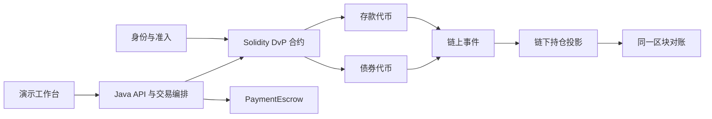

# TokenRail

**Programmable Settlement Lab for Tokenized Banking**

面向银行金融场景的可编程结算实验平台：用存款代币、债券代币和 Solidity 智能合约，演示券款原子交割、参与方准入及链上链下对账。

**当前状态：M7 / v0.1.0 已完成本地干净环境发布验收。** 51 个合约测试、四节点 QBFT 故障恢复、8 个 M4–M5 Besu 回归、8 个 M5.1 独立可靠性测试、2 个 M6 全栈场景和 3 个 M7 对外演示场景全部通过。详见 [M7 发布证据](docs/evidence/m7-release-20260914/README.md)和 [v0.1.0 发布说明](RELEASE_NOTES.md)。

核心案例：投资者 B 使用 1,000,000 元模拟存款代币，购买投资者 A 的 1,000 单位 ABC2029 债券。两条资产转移在同一笔 EVM 交易中完成；任一转移失败，双方的代币余额均保持不变。随后，Java 服务消费事件并更新链下持仓。



## 设计导航

| 文档 | 内容 |
|---|---|
| [需求与范围](docs/product-design.md) | 项目目标、用户、版本边界与业务假设 |
| [系统设计](docs/architecture/system-design.md) | 组件、数据模型、接口、状态与故障恢复 |
| [合约设计](docs/architecture/contracts.md) | 授权、DvP、发行赎回、条件支付与不变量 |
| [演示与验收](docs/scenarios/acceptance.md) | 固定数据、成功失败案例和验证证据 |
| [开发路线](docs/roadmap.md) | 分阶段交付、学习目标与完成标准 |
| [设计决策](docs/adr/0001-design-baseline.md) | 技术选择、取舍、待实测事项与官方参考 |
| [学习记录模板](docs/concepts/README.md) | 每阶段需要自己解释的问题 |
| [合约运行说明](contracts/README.md) | 已实现接口、角色、金额单位与本地验证 |
| [M2 学习记录](docs/concepts/03-atomic-dvp.md) | 双方确认、原子交换、失败回滚与边界 |
| [Besu 网络运行说明](deploy/besu/README.md) | 四节点启动、部署、验收、清理与本地安全边界 |
| [M3 学习记录](docs/concepts/04-qbft-and-permissioning.md) | QBFT quorum、许可层次、genesis 与 deploymentId |
| [Java 服务运行说明](apps/server/README.md) | M4 环境、API、完整验收与可靠性边界 |
| [M4 学习记录](docs/concepts/05-reliable-chain-workflow.md) | 幂等、nonce、UNKNOWN 与跨链库恢复 |
| [M5.1 接口与运行](docs/m51-api-and-operations.md) | 角色、幂等后台任务、迁移和租约配置 |
| [M5.1 学习记录](docs/concepts/07-reliability-boundaries.md) | 真实崩溃、固定区块账务与差异复核 |
| [M5 学习记录](docs/concepts/06-projection-and-reconciliation.md) | Transfer 投影、区块 checkpoint、历史对账与重建 |
| [M6 接口与运行](docs/m6-api-and-workbench.md) | 业务 API、角色、工作台和全栈验收 |
| [M6 学习记录](docs/concepts/08-business-orchestration-and-escrow.md) | 条件支付、证明边界与三层状态 |

## 计划技术栈

已锁定 Solidity 0.8.30、OpenZeppelin 5.6.1、Foundry 1.7.1、Java 21、Spring Boot 4.1.1、Web3j 5.0.2、Besu 26.8.1 和 PostgreSQL 18.6。工作台采用 Spring Boot 静态托管的原生 HTML/CSS/JavaScript，免去单独的前端构建链。

先用 Foundry 与 Anvil 完成合约实验，再在四节点 Besu 网络验证；Java 采用一个应用内的模块化单体，界面最后接入。具体依赖版本在首个开发里程碑验证并锁定。

v0.1 聚焦单链、单一模拟存款发行行、一种模拟债券，保留条件支付、原子 DvP、合规拒绝三个演示。跨行最终结算、跨链、完整托管、真实资金及 AI Agent 不在首版范围。

本项目使用合成数据和本地测试身份。技术上的链上原子性不覆盖银行账务系统，也不代表真实金融资产的法律最终性。代码使用 [Apache License 2.0](LICENSE)。

## 运行与发布验收

需要 Node.js 20+ 和 jq。Foundry 作为项目依赖固定为 v1.7.1，无须全局安装：

```bash
cd contracts
npm ci
npm run check

cd ..
scripts/check-m0-environment.sh
scripts/m0-anvil-transaction.sh
scripts/m2-anvil-atomicity.sh

scripts/besu-network.sh up
scripts/deploy-m3-contracts.sh
scripts/test-m3-besu.sh

scripts/m4-environment.sh
set -a
source deploy/.runtime/m4/server.env
set +a
mvn -f apps/server/pom.xml spring-boot:run

# 完整 M4 验收
scripts/test-m4-java.sh

# M4–M5 基础回归
scripts/test-m5-projection.sh

# 独立链与数据库上的 M5.1 可靠性验收
scripts/test-m51-reliability.sh

# M6 业务 API 与 PaymentEscrow 全栈验收
scripts/test-m6-fullstack.sh

# 从当前 commit 的干净 git archive 执行 M0–M7 发布验收
scripts/test-m7-release.sh

# 运行条件支付、DvP 与合规拒绝/重试，并保留工作台
scripts/demo-m7-scenarios.sh --keep-running

# 使用真实浏览器生成六个证据画面和 MP4 录屏
scripts/record-m7-demo.sh
```

M0 Anvil 脚本只启动临时本地链，进程内生成一次性测试密钥，并验证地址推导、签名、广播、receipt、nonce、状态写入和 revert 回滚。密钥不写入文件或日志。已执行结果见 [M0 本地证据](docs/evidence/m0-local-20260913/README.md)，原理说明见 [M0 学习记录](docs/concepts/01-evm-transaction-and-revert.md)。

M1 的身份与代币测试包含在同一个 `npm run check` 中。结果见 [M1 本地证据](docs/evidence/m1-contracts-20260913/README.md)，原理说明见 [M1 学习记录](docs/concepts/02-identity-and-tokenization.md)。

M2 的 DvP 单元、模糊和状态不变量测试也包含在 `npm run check` 中。最后一个 Anvil 脚本会广播一笔第二腿必然失败的真实交易，并核对失败 receipt 和回滚后的链上状态。结果见 [M2 本地证据](docs/evidence/m2-dvp-20260913/README.md)，原理说明见 [M2 学习记录](docs/concepts/03-atomic-dvp.md)。

M3 使用固定 digest 的 Besu 26.8.1 镜像。网络脚本生成新的本地验证者和部署账户，生成物全部位于被忽略的 `deploy/.runtime/`；RPC 仅绑定本机。完整故障验收约需一分钟，结束后保留已恢复的四节点网络供检查，可运行 `scripts/besu-network.sh down` 停止。结果见 [M3 本地证据](docs/evidence/m3-besu-20260913/README.md)。

M4 增加 Java 21 / Spring Boot / Web3j 服务和 PostgreSQL。写请求先落库，后台 worker 在数据库事务外签名广播；UNKNOWN 交易、mint 后数据库失败及 burn 后入账失败均可恢复。结果见 [M4 本地证据](docs/evidence/m4-java-20260914/README.md)。

M5 增加 ERC-20 Transfer 索引、逐区块事务、投影版本、历史快照和对账报告。已有集成测试覆盖重复事件、滞后与投影重建；区块中断、历史不可用与 checkpoint 损坏使用受控故障注入。真实进程终止和独立链重置另见 M5.1 证据。结果见 [M5 本地证据](docs/evidence/m5-projection-20260914/README.md)。

M6 增加 PaymentEscrow、券款交割/条件支付/身份与运维业务 API，以及由 Spring Boot 静态托管的四页响应式工作台。T09 覆盖未授权放款、提前退款、终态重放和合规边界；T20 在真实 Besu、PostgreSQL 与 HTTP 上覆盖发行、转换、授权、DvP、Escrow 和投影。结果见 [M6 本地证据](docs/evidence/m6-fullstack-20260914/README.md)。

M7 从已提交的 `git archive` 创建临时工作区，重装依赖并重跑 M0–M6 所有发布门禁。三场景脚本额外验证 Escrow release/refund、DvP 成功与余额不足原子回滚、冻结拒绝与解冻重试；Playwright 画面、MP4 和结构化结果见 [M7 本地证据](docs/evidence/m7-release-20260914/README.md)。
