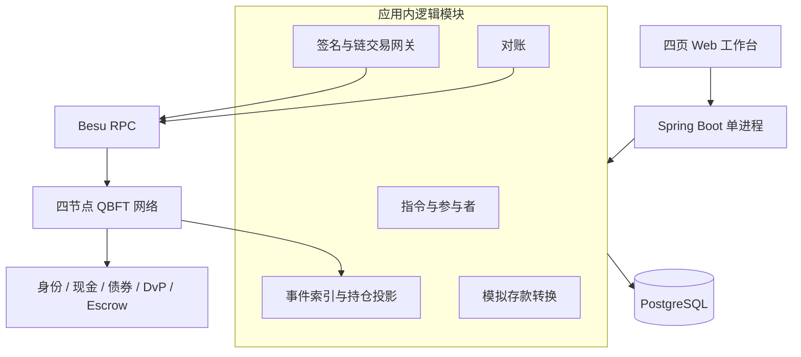
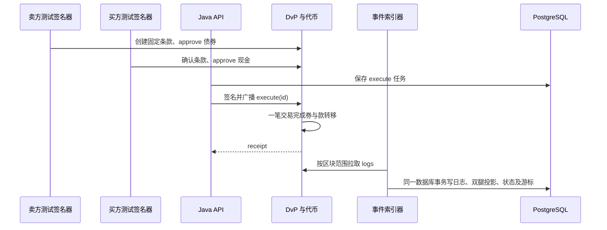

# 系统设计

状态：M0–M6 已实现并通过本地验收。历史银行账与在途金额使用数据库一致性快照和链上 receipt 还原；任务租约、运行时部署隔离、独立版本重建、条件支付和工作台均已落地。

## 1. 组件与部署



一个 Java 应用承载逻辑模块，不提前拆 Maven 多模块或微服务。单个 PostgreSQL 数据库承担业务数据、任务 outbox、索引游标和投影。无 Kafka、Redis、Kubernetes。后台轮询采用可配置批次与退避，不依赖 WebSocket 作为唯一事件来源。

目标目录：

```text
apps/server/                 Maven，包名 io.tokenrail
  .../participant/           身份与地址映射
  .../settlement/            指令、尝试记录、API
  .../gateway/               Web3j、签名器、nonce、receipt
  .../ledger/                存款转换与代币持仓投影
  .../reconciliation/        同区块比较与差异
apps/server/.../static/      无构建依赖的四页演示工作台
contracts/src/               五个业务合约；core 阶段四个
contracts/test/              unit / fuzz / invariant
contracts/script/            部署与初始化
deploy/besu/                 genesis、许可配置与节点配置
deploy/compose.yaml          本地端到端环境
scripts/                     启动、演示、验证；明确演示专用操作
docs/                        设计、学习、证据
```

Anvil 用于快速开发；四个 Besu 验证节点用于正式演示。所有节点在一台机器只是协议实验，不是独立故障域。四节点测试一节点退出仍出块、两节点退出停止出块；后者显示 NETWORK_STALLED 而非业务失败。依据见 [Besu QBFT](https://docs.besu-eth.org/private-networks/how-to/configure/consensus/qbft)。

部署生成 manifest，记录 deploymentId、chainId、genesisHash、各合约地址、部署区块及 hash、ABI hash、bytecode hash、工具版本。相同 chainId 的链重置也必须产生新 deploymentId，禁止混用旧投影。编译 EVM 目标必须与 Besu genesis 激活的硬分叉兼容。

RPC 默认只绑定 localhost，容器内连接用私有网络；节点和账户许可配置独立于合约准入。本地使用有限 gas 与测试原生币，原生币不作为 DvP 的现金腿。权限网络本身不隐藏账本数据。

## 2. 真相来源与状态

链上合约是代币持仓与交割状态的事实来源；数据库普通存款余额是模拟银行账本事实；offchain_position 是代币事件的可重建投影，不是另一份可自由修改的资产所有权账本。

不要用一个 status 混合全部生命周期：

| 维度 | 状态 |
|---|---|
| 指令本地准备 | DRAFT → CREATE_PENDING → 已观察链上状态 |
| 链上业务 | CREATED / READY / SETTLED / CANCELLED / EXPIRED |
| 每次链交易尝试 | PREPARED / SIGNED / BROADCAST / UNKNOWN / MINED_SUCCESS / MINED_REVERT |
| 同步 | PENDING / APPLIED / ERROR |

API 超时不将指令改成 FAILED。receipt status=1 只证明该笔交易成功；只有对应 SettlementExecuted 与合约状态才证明交割完成。已交割但索引暂停显示“链上完成，持仓同步中”。



## 3. 双方身份与密钥

本地 demo profile 提供相互独立的 A、B、发行员、合规员及结算提交员签名器。测试身份令牌绑定角色和钱包，API 不接受任意 userId/header 作为可信身份。仅 seller 能创建，只有指定 buyer 能确认，任一交易方可取消，operator 仅 execute。

本地服务持有全部测试密钥，所以这只模拟机构托管授权，不能证明独立机构控制。Signer 接口隔离本地 keystore 实现；测试密钥临时生成、密码从环境注入、不记日志、不进入版本库。生产密钥管理不在首版范围。

交易内容在签名前校验 chainId、目标合约、调用方法、参与者、金额与关联指令。浏览器和普通 API 没有通用“任意 calldata 签名”能力。部署管理员的凭据不提供给日常 execute 路径。

## 4. 链交易可靠提交

1. REST 写操作要求 Idempotency-Key。按参与者 + 路由 + key 唯一保存规范化 requestHash；同 key 同 payload 返回同一 operationId，不同 payload 返回 409。
2. 在一个数据库事务中保存命令与 outbox，再由后台提交。网络调用不置于持仓数据库事务中。
3. 对每个 signer 串行分配 nonce，结合节点 pending nonce 与数据库已分配值；唯一约束 `(deploymentId, signer, nonce)`。用户钱包不能同时被外部程序用于提交交易。
4. 广播前持久化签名交易及其 hash（签名字节限制访问、不进日志），之后广播。崩溃后查 hash / receipt；可重发相同字节，不能另造业务指令 ID。
5. RPC 超时置 UNKNOWN 并退避查询。首次请求失败不证明未入链。首版不自动提高 gas 替换交易；长期 pending 阻塞后续同 signer 队列，并提供检查信息。
6. 若外部程序意外使用相同 nonce，检查链上业务 ID；无法确定时进入人工检查，不能自动再 mint 或释放冻结存款。
7. 已确定 MINED_REVERT 后，业务原因可修复时允许新 nonce 重试同一业务 ID。终态 ID 合约拒绝重放。

精确一次网络投递不可保证；系统以至少一次发送 / 消费，加唯一约束与链上 ID 获得幂等效果。Web3j 包装器由 ABI 生成并检查一致性；同步调用封装在后台 worker，不让 HTTP 一直等出块。参考 [Web3j 合约交互](https://docs.web3j.io/4.14.0/smart_contracts/interacting_with_smart_contract/)。

## 5. 最小数据模型

数据库地址规范化为 20 字节或固定小写十六进制；hash 为 32 字节。所有 uint256 用 numeric(78,0)，ID 用 UUID 或 bytes32 映射。金额限制与 Token 精度一致。

| 表 | 关键字段和约束 |
|---|---|
| participant / wallet | participantId、角色、合成机构标识；wallet 地址唯一 |
| deployment / asset | 网络身份、ABI、合约地址、decimals；资产归属某次部署 |
| settlement_instruction | id、seller、buyer、asset、quantity、cashAmount、expiry、链上状态；已提交条款不可改 |
| api_request / outbox | actor、route、key、requestHash、operationId、payload、重试时间 |
| chain_transaction | operationId、method、signer、nonce、rawTx、txHash、receipt、错误码；每次尝试可追溯 |
| chain_event | deploymentId、blockHash、txHash、logIndex、地址、topics、data；四元组事件身份唯一 |
| indexer_checkpoint | deploymentId、projectionVersion、blockNumber、blockHash；游标为完整区块边界 |
| position_entry | eventId、wallet、asset、delta；每事件钱包分录唯一 |
| offchain_position | deploymentId、projectionVersion、wallet、asset、balance；非负；完整区块水位 |
| deposit_account / deposit_operation | 参与者、available、reserved；conversion / redemption ID、金额、状态 |
| deposit_journal | operationId、postingKind、借贷方向、amount；postingKind 唯一防重复入账 |
| reconciliation_run / reconciliation_break | deploymentId、blockNumber、blockHash、projectionVersion、差值、类型及处置记录 |
| audit_record | 操作者、动作、关联 ID、时间、结果；不保存私钥 |

不增加独立 trade 撮合实体：settlement_instruction 含 externalTradeRef 即可。索引持仓包含所有允许钱包及 Escrow 地址，mint 来源零地址和 burn 去向零地址不建立普通钱包余额。

## 6. 存款发行与赎回

发行流程 `RESERVED → MINT_PENDING → COMPLETED`：数据库先原子减少 available、增加 reserved；之后 issuer 用同一 conversionId mint。观察到成功 mint 后，数据库将 reserved 转为 aggregate token liability backing（代币负债支持金额）。余额不足时在数据库阶段拒绝。

若广播超时，继续保留 reserved，直到查明状态；只有证明交易已 revert 且该业务 ID 未成功，才允许撤销并回 available。撤销和重试必须由同一 operation 锁串行化，禁止二者并发。发行员仅受控 worker 可签名该操作。

赎回流程 `BURN_PENDING → BURN_CONFIRMED → CREDITED`：持币人用唯一 redemptionId 烧毁自己的代币；索引确认事件后向该持币人在同一发行行的普通账户入账，同时减少 aggregate backing。不向最初提供资金的客户退款，代币已经可能转手。

数据库入账失败时保持 BURN_CONFIRMED，幂等重试 CREDITED；不能再次 burn，更不能为“补偿”擅自 mint。身份不合格导致 burn 回滚时不得入账。

无操作在途时，`aggregate backing = totalSupply`（均用现金最小单位）。在途核对使用：`链上 supply = 已入账 backing + 已 mint 未转 backing 金额 - 已 burn 未扣 backing 金额`；未成功 mint 的 reserved 不计入 supply。报告同时列出在途金额，不能把合法延迟都标为资金损失。所有项在同一索引区块水位核对。

这一流程跨数据库和链，不是原子事务。它是具有幂等 ID 和恢复步骤的工作流；chain atomicity 只用于 DvP 的两条代币转移。

## 7. 事件投影与对账

按 blockNumber、transactionIndex、logIndex 排序，从部署区块扫描。ERC20 Transfer 是唯一持仓增减来源；SettlementExecuted、MintConverted 等领域事件只驱动业务关联，不能再加减余额。Transfer mint / burn 按零地址规则处理。

每个完整区块在一个数据库事务中：去重保存 logs，生成 position_entry，更新所有受影响持仓，更新指令与游标。进程中断整块回滚；重扫整块不会重复记账。漏事件可从已提交游标重拉，不能仅凭 WebSocket 恢复。

对账选择已完整投影的区块 H，读取该 projectionVersion 在 H 的持仓快照；在同一数据库快照中固定水位与持仓，再以 H 查询链上 balanceOf / totalSupply。比较前后核验 H 的 blockHash。节点不支持该历史高度时，报告 SNAPSHOT_UNAVAILABLE，不能改用 latest 凑结果。

`delta = onchain - offchain`，按资产最小单位精确比较。LAG（索引落后）、POSITION_MISMATCH（同区块差异）、BACKING_MISMATCH（存款支持金额）、CHAIN_DIVERGENCE（区块 hash 不符）分别显示。

QBFT 正常运行按其最终性处理已提交区块；checkpoint hash 仍要核验。发现不符暂停写投影与对账，保留旧版本，重建新 projectionVersion；链重置需新的 deploymentId 并重新 seed，不能把旧链普通存款操作自动再次兑现。

修复仅重建可派生的代币投影。存款 CREDITED 等经济分录通过唯一 operationId 防重放，不能在投影重建中重做。对账差异不触发自动链上转账，不直接覆盖链上余额。旧差异标为已解决并关联新报告，保留审计。

## 8. REST 行为契约

所有写接口返回 202 `{operationId, resourceId, submissionStatus}`；不以 HTTP 成功表示链上成交。金额字段示例 `"cashAmount":"100000000"`、`"bondQuantity":"1000"`。expiry 用 UTC 时间转秒，服务不静默四舍五入。

| 路由 | 授权与含义 |
|---|---|
| POST /api/v1/settlements | seller；指定 buyer、两资产 ID、数额、expiry、externalTradeRef |
| POST /api/v1/settlements/{id}/confirm | buyer；确认读取的不可变条款 |
| POST /api/v1/settlements/{id}/execute | operator；同一指令最多一个未决 execute |
| POST /api/v1/settlements/{id}/cancel | buyer 或 seller；链上排序决定是否赶上 |
| POST /api/v1/allowances | 钱包本人；仅允许部署清单内资产与 DvP / Escrow spender |
| POST /api/v1/deposit-conversions | 账户本人请求，发行 worker 执行；reserve + mint |
| POST /api/v1/redemptions | 钱包本人；burn 后恢复模拟存款 |
| POST /api/v1/identities/{wallet}/status | 合规员；链上更新身份 |
| POST /api/v1/payments、/{id}/release、/{id}/refund | payer / attestor / payer，按 Escrow 规则 |
| POST /api/v1/reconciliations | 对账员；指定或固定可用水位 |
| GET /api/v1/operations/{id} | 尝试历史、receipt 与业务状态 |
| GET /api/v1/settlements/{id} | 条款、双方确认、链上状态、同步状态 |
| GET /api/v1/positions、/reconciliations/{id} | 数据必须带 deploymentId、blockNumber、blockHash |

400 为输入或单位错误、403 为身份无权、404 为资源不存在、409 为幂等冲突或不允许的业务状态；异步 revert 在 operation 中返回领域错误，例如 INSUFFICIENT_CASH、PARTICIPANT_INELIGIBLE、ALLOWANCE_TOO_LOW。预检通过仍不保证实际执行成功。

## 9. 运行可观测性

结构化日志连接 instructionId / operationId / txHash / blockHash。指标覆盖 head、indexedBlock、lag、最老 UNKNOWN 时长、revert 分类、未完成转换金额、对账差异数。应用 health 区分 API 活着、RPC 可读和网络是否持续出块。

不预先宣称 TPS 或秒级 SLA。首版记录测试机器、固定区块周期、从广播至 receipt / 投影的延迟分布及 gasUsed；以复现正确性为发布门槛。
